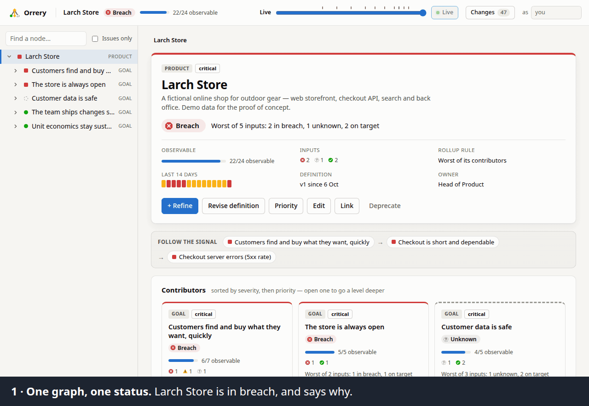

<p align="center">
  <picture>
    <source media="(prefers-color-scheme: dark)" srcset="docs/brand/logo-dark.svg">
    
  </picture>
</p>

# Orrery

**Requirements, constraints and business + quality KPIs as one living,
observable graph.** You see it whole from the top, explore it one level at a
time, and it evolves without rewriting its past.

<p align="center">
  <picture>
    <source media="(prefers-reduced-motion: reduce)" srcset="docs/tour-still.png">
    
  </picture>
</p>

> Proof of concept. The demo data describes **Larch Store**, a fictional online
> shop, with thirty days of history and an incident in progress.

## Run it

Node ≥ 20.19 and pnpm.

```bash
pnpm install
pnpm dev        # API :4710 + UI :5710 (Vite) + live signal simulator
```

Open <http://localhost:5710>. The first start seeds `data/events.jsonl`.

| Command | What it does |
|---|---|
| `pnpm start` | Build the UI and serve everything from :4710 |
| `pnpm reset` | Re-seed the demo relative to now. Stop the server first; the old log is kept as `<log>.<instant>.bak` |
| `pnpm verify` | Typecheck, unit and API tests, UI build |
| `pnpm --filter @ru/web e2e` | Browser smoke test against a running app (writes to the log) |
| `pnpm --filter @ru/web a11y` | Accessibility scan against a running app (reads only) |
| `pnpm --filter @ru/web readme-gif` | Re-record the picture above against a freshly reset, running app (reads only; needs ffmpeg) |
| `pnpm dogfood` | Measure this repository against its own requirements ([below](#the-repository-measures-itself)) |

## The idea

| Need | How the PoC answers it |
|---|---|
| Build and manage requirements & constraints | One recursive **node** type: product → goal → requirement / constraint → KPI / scenario. A **link** lets one node evidence several parents |
| Business + quality KPIs | A node can carry a **measure** (unit, better-when, target, warning threshold, staleness). Scenarios carry stimulus / environment / response and a pass/fail check. Dimensions come from the [arc42 Quality Model](https://quality.arc42.org/), plus `business` |
| High-level monitoring | Every node has a **status** (on target / warning / breach / unknown), a one-line **reason**, **coverage** (how much beneath it is actually measured) and a 14-day **ribbon** |
| Progressive disclosure | The focus view shows one node and exactly one level below it. Tiles drill down, the breadcrumb climbs back, and **Follow the signal** jumps straight from a red goal to the reading that caused it |
| Iterative refinement | A one-line stub is legitimate. It shows as **unknown**, never green, and sits in the **Not yet observable** backlog of everything above it until someone refines it |
| Dynamic evolution | Targets, rollup rules, priorities, structure and lifecycle change through **reasoned, append-only events**. A reading stays judged against the definition in force when it was taken, and **time travel** shows the universe as it was known on any day |

## A five-minute tour

1. **Top level.** Larch Store is in **breach**. *Follow the signal* →
   *Customers find and buy…* → *Checkout is short and dependable* →
   *Checkout server errors (5xx rate)*: a checkout incident began six hours
   before the seed. The 5xx KPI lives under *availability* but is **linked** to
   checkout too, so it counts in both places. The simulator keeps the incident
   going for three hours after seeding, then lets it recover live. Watch the
   top level fall back to *warning* (the tightened p95 target remains). To
   replay the story: stop `pnpm dev`, `pnpm reset`, start again.
2. **Customer data is safe** is **unknown**, not green. Legal added an EU
   residency constraint eight days ago, and its audit scenario has never run.
   Its coverage reads 4/5.
3. **Pages feel instant → Product page latency (p95).** The chart's zones
   change eighteen days ago, when the target was tightened from ≤ 800 ms to
   ≤ 500 ms (v2, with its reason). Earlier readings stay blue, later ones
   amber: same values, different yardstick, and nothing was repainted.
4. **Time travel.** Drag the slider back three weeks. The KPI is green again,
   the requirement is back to *medium* priority, and *Search finds relevant
   products* does not exist yet. Ticks on the slider mark model changes.
5. **Evolve it.** Open *Search finds relevant products* (an unrefined stub) →
   **+ Refine** → add a KPI → **Record reading** → **Revise definition**
   (a reason is required). Watch coverage, the parent's status and the
   **Changes** feed update.

## Why it is built this way

| ADR | Decision |
|---|---|
| [0001](docs/adr/0001-one-graph-append-only-evolution.md) | One graph, append-only evolution: the four decisions everything rests on |
| [0002](docs/adr/0002-metrics-bind-to-configured-sources.md) | Metrics bind to configured Prometheus and Grafana sources |
| [0003](docs/adr/0003-the-repository-measures-itself.md) | The repository measures itself |
| 0004–0012 | How each quality is tested: [efficiency](docs/adr/0004-efficiency-shape-in-the-suite-size-in-the-dogfood.md), [flexibility](docs/adr/0005-flexibility-is-tested-as-promises.md), [maintainability](docs/adr/0006-maintainability-structure-counted-diagnosis-pinned.md), [operability](docs/adr/0007-operability-what-whoever-runs-it-can-rely-on.md), [reliability](docs/adr/0008-reliability-what-it-acknowledged-survives.md), [safety](docs/adr/0009-safety-no-one-acts-on-a-green-it-has-not-earned.md), [security](docs/adr/0010-security-the-browser-is-the-way-in.md), [usability](docs/adr/0011-usability-everyone-can-read-and-operate-it.md), and [suitability](docs/adr/0012-suitability-it-does-what-the-readme-says.md) (it does what this README says) |
| [0013](docs/adr/0013-modules-bring-what-core-does-not-know.md) | Modules bring what core does not know: query languages and source kinds. Prometheus is one |

## The repository measures itself

The platform's own requirements form a second universe, kept apart from the
demo: eleven goals, from *The model tells the truth* to *It does what the README
says it does*. Definitions are code in
[`model.ts`](apps/server/src/dogfood/model.ts). Readings come from versioned
probes in [`probes.ts`](apps/server/src/dogfood/probes.ts), and only committed
code is recorded.

```bash
pnpm dogfood [--dry-run]   # sync the model, measure, record, print the tree (~3 min)
pnpm dogfood:serve         # the dogfood universe in the console on :4711
```

The goals, the measurement rules, how each quality is tested and how to change
the model are in [docs/dogfood.md](docs/dogfood.md).

## Feeding it data

Readings arrive through one generic webhook, which is what the simulator uses:

```bash
curl -X POST localhost:4710/api/readings -H 'content-type: application/json' \
  -d '{"readings":[{"nodeId":"k-5xx","value":0.04,"source":"prometheus"}]}'
```

- `observedAt` (ISO-8601) is optional and may be in the past. A batch is
  all-or-nothing.
- The simulator feeds only the demo. In a universe whose top level is not
  Larch Store, it says why and writes nothing, because its made-up readings
  would pass for real ones there.
- Set `RU_INGEST_TOKEN` to require `Authorization: Bearer …` on every reading,
  by either route: the webhook and a `reading.record` command alike. While it
  is set, the console cannot record a reading by hand, because it has no way
  to hold the token. Without it, readings can also be recorded by hand from
  any measured node.

<details>
<summary><b>Pulling from Prometheus or Grafana</b></summary>

A measured node can carry a **binding**: the PromQL query that defines its
number, optionally with a configured **source** that runs it. *Revise
definition* sets it (a new query is a new definition version, with a reason).
*Edit* sets a **dashboard link** for people to follow. The demo documents the
queries behind its three Prometheus KPIs and links them to a (fictional)
Grafana. The simulator still pushes their readings.

To have the server pull, configure sources and bind a node to one:

```bash
docker run -d -p 9090:9090 prom/prometheus      # or use your own
cp apps/server/sources.example.json sources.json # edit ids, URLs, steps
RU_SOURCES_FILE=sources.json pnpm dev
```

- Each source is pulled every `stepSeconds` (default 300). Instants are on a
  fixed grid, wait `settleSeconds` for scrapes to land, and catch up after
  downtime up to 24 h, never before the binding took effect.
- Pulled readings are stored as `source: "pull:<id>"`. Only the collector may
  use that prefix.
- A failed, empty, multi-series or non-finite answer records nothing, so the
  node goes stale and **unknown**. `GET /api/sources` and the node view say why.
- Grafana is a route, not a kind: set `grafana.datasourceUid` and a Viewer
  token (by env var name, `tokenEnv`). Requests then go through Grafana's
  datasource proxy, and "Open in Grafana Explore" uses `publicUrl`.
- Tokens are never stored in the log or returned by the API. With sources
  configured, the server refuses a non-loopback `HOST` unless
  `RU_ALLOW_REMOTE=1`, because commands are unauthenticated.

</details>

<details>
<summary><b>What keeps a web page out</b></summary>

Commands carry no credentials, so the operator's own browser is the way in for
anyone else ([ADR 0010](docs/adr/0010-security-the-browser-is-the-way-in.md)).

- **Names.** The server answers only to IP addresses, `localhost`, the name in
  `HOST` and the names in `RU_ALLOWED_HOSTS`. Any other `Host` gets a 403, so a
  page whose DNS name has been rebound to the server reads and writes nothing.
  If you reach the server by a name, list it.
- **Writes.** A write that carries an `Origin` other than the server's own is
  refused. curl, CI and the simulator send none.
- **Headers.** Every answer forbids framing, code from anywhere else and MIME
  sniffing.
- **Trace.** Each refusal is logged as a warning with the request id and where
  it came from, never the credentials offered.

</details>

## API

| Method | Path | Purpose |
|---|---|---|
| `GET` | `/api/universe?asOf=` | Every node with status, reason, drivers, coverage, ribbon, sparkline |
| `GET` | `/api/nodes/:id?asOf=` | Definition versions, history, reading series judged per version |
| `GET` | `/api/changes?asOf=&limit=` | The model's change feed (readings excluded) |
| `POST` | `/api/commands` | `node.create · edit · redefine · reprioritize · move · link · unlink · deprecate · reactivate`, `reading.record` |
| `POST` | `/api/readings` | Ingestion webhook (single reading or `{ readings: [...] }`) |
| `GET` | `/api/sources` | Configured metric sources (public fields only), each binding's pull state and drill-out link, and the query languages the installed modules bring |
| `GET` | `/api/health` | Liveness, how many events the log holds and when the last was recorded |

- Commands are validated by `decide` in the core: unknown ids are 404, cycles
  and duplicate state are 409, and missing reasons or malformed measures are
  400.
- The optional `x-actor` header names the author (there is no authentication
  in the PoC). `ingest` and `collector` are the server's own writers and are
  refused.
- `asOf` is an ISO-8601 date (read as UTC midnight) or a date-time with `Z` or
  an offset. A date-time without a zone is refused, so an answer never depends
  on the server's time zone.
- An internal error answers 500 with a `requestId`; the server's log records
  the error under the same id.

## Configuration

Everything is set through environment variables, and nothing is required. An
empty value means unset. A value the server cannot use stops it at start, with
a message naming the variable. A relative path is read from the directory the
command was typed in: pnpm passes it as `INIT_CWD`, and without it the working
directory is used.

<details>
<summary><b>All variables</b></summary>

| Variable | Default | Used by | What it does |
|---|---|---|---|
| `RU_DATA_FILE` | `data/events.jsonl` | server, `reset` | The event log |
| `RU_SEED` | `demo` | server, `reset` | What an empty log starts as: `demo` or `dogfood` |
| `PORT` | `4710` | server, `reset`, simulator | The API port |
| `HOST` | `127.0.0.1` | server, `reset`, simulator | The address the API binds to |
| `RU_WEB_DIST` | `apps/web/dist` | server | The built UI to serve, if present |
| `RU_INGEST_TOKEN` | unset | server, simulator | Requires `Authorization: Bearer …` on every reading, through `POST /api/readings` or a `reading.record` command |
| `RU_SOURCES_FILE` | unset | server | Metric sources to pull from (see above). Their tokens are named by `tokenEnv` |
| `RU_ALLOW_REMOTE` | unset | server | `1` allows a non-loopback `HOST` with sources configured |
| `RU_ALLOWED_HOSTS` | unset | server | Host names, comma-separated, a request may name besides IP addresses, `localhost` and `HOST`; `.example.org` covers every name under it |
| `RU_API` | `http://HOST:PORT` (simulator), `http://127.0.0.1:4710` (Vite) | simulator, Vite dev server | Where the API is |
| `RU_SIM_TICK_MS` | `30000` | simulator | How often the fast signals move |
| `RU_DOGFOOD_FILE` | `data/dogfood.jsonl` | `dogfood`, `dogfood:serve` | The repository's own log |
| `RU_DOGFOOD_PORT` | `4711` | `dogfood`, `dogfood:serve` | Its port |
| `RU_DOGFOOD_URL` | `http://127.0.0.1:RU_DOGFOOD_PORT` | `dogfood` | A running dogfood server to record into; without one, the run writes the log directly |
| `RU_PROBE_ENV` | `local` | `dogfood` | Labels the machine; compare timings within one label |
| `NO_COLOR` | unset | `dogfood` | Prints the report without colour |
| `RU_URL` | `http://127.0.0.1:4710` | `e2e`, `a11y`, `readme-gif` | The app the browser scripts drive |
| `PW_CHROMIUM` | unset | `e2e`, `a11y`, `readme-gif`, `dogfood` | A Chromium binary for the browser scripts |

</details>

The demo and the dogfood servers default to different logs and ports, so both
can run at once. One process writes a log at a time: a running server keeps
`<log>.lock` beside it, and a second writer, `pnpm reset` included, is refused
with the writer's pid. A lock left behind by a crash is taken over at the next
start. Ctrl-C or SIGTERM closes the server, letting the requests in flight
finish, and releases the log before it exits. A second Ctrl-C, a second or
more later, stops it at once.

## Layout

```
packages/core         pure domain — schemas, projection, evaluation & rollup, history, read models;
                      it names no query language and no source kind
packages/module-kit   the contract a module implements: query languages and source kinds (ADR 0013)
packages/prometheus   a module: PromQL and the Prometheus source kind, directly or through Grafana
apps/server           Fastify shell, append-only JSONL event store, demo seed, simulator,
                      the installed modules (src/modules.ts), source settings and the pull collector (src/sources),
                      the dogfood model, probes and runner (src/dogfood)
apps/web              React + TanStack Query UI — outline, focus view, chart, dialogs, time travel
docs/adr              architecture decisions
```

A system to pull from, or a language a binding is written in, is a module: a
package implementing `@ru/module-kit`, added to `apps/server/src/modules.ts`
and to the server's dependencies. Core, the log's shape and the console stay as
they are. The console learns what to say about a language, and where a query
opens, from `GET /api/sources`.

## What is deliberately missing

- **Identity and tenancy.** The author is self-declared, and there is one
  universe per log. Anyone who can reach the API can change the model; the
  ingest token guards readings only (ADR 0010).
- **Scale.** The view is re-projected from the full log on each request.
  That's fine for thousands of events, not for millions of readings. The
  simulator adds ~17k readings a day while `pnpm dev` runs (6 fast signals
  every 30 s; `RU_SIM_TICK_MS` changes it), so `pnpm reset` now and then on a
  long-running demo. Each reset keeps the log it replaced as a `.bak` file
  beside it (ADR 0009), and nothing prunes them: delete the ones you no longer
  need.
- **Other languages, and accessibility tested by people.** The console is
  English only. Its accessibility is checked by machine (ADR 0011), not yet by
  anyone using a screen reader, a keyboard alone or magnification.
- **Integrations beyond Prometheus.** Prometheus (directly or through Grafana)
  can be pulled (ADR 0002). It is the one source module installed (ADR 0013).
  Datadog, SQL or analytics sources and alert webhooks are not built. CI
  reporters push into the webhook.

## Next steps

1. **Requirements as code.** The dogfood universe is the first slice
   (ADR 0003): definitions in a reviewed file, reconciled through `decide`.
   Next, make the format a product feature (YAML beside any codebase, imported
   the same way) and run the probes in CI.
2. **Integrations.** More source kinds as modules (ADR 0013): Datadog, SQL or
   analytics for business KPIs. Also JUnit/CI results feeding scenarios, and
   authentication on commands so bindings can safely target shared monitoring.
3. **Impact preview.** Before publishing a new target or priority, show which
   ancestors would change status ("this makes *Pages feel instant* amber").
4. **Storage.** Snapshots plus a time-series table (Postgres) once the reading
   volume grows; the definition log stays event-sourced.
5. **Alerting and ownership.** Notify a node's owner when it enters breach or goes
   stale; add per-team views of the same universe.
